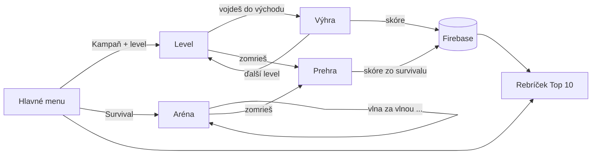

<div align="center">

# 💀 DOOM – Unity klon

**Retro first-person strieľačka inšpirovaná pôvodným Doomom (1993)**


*Školský tímový projekt · nadväzuje na [Car Race Master](https://github.com/Horvy10/car-race-master)*

</div>

---

## 🎮 O čom je hra

Si sám v tmavej základni plnej démonov. Prebíjaš sa chodbami a miestnosťami, zbieraš zbrane, muníciu a kľúče a hľadáš **zelený východ**, ktorý ťa pustí do ďalšieho levelu. Nepriatelia ťa počujú strieľať, naháňajú ťa po mape a útočia zblízka aj zďaleka. Čím ďalej si, tým sú silnejší.

Celá grafika, modely, častice aj zvuky sa **generujú kódom**, v projekte nie sú žiadne cudzie assety. Obraz má nízke rozlíšenie s ostrými pixelmi, aby pripomínal hry z 90. rokov.

```
###############          #  stena          P  ty (štart)
#P..h..#......#          z  zombie         E  východ
#......#..z...#          i  imp            D  dvere
#..b...D......#          d  démon          h  lekárnička
#......#...z..#          b  náboje         S  brokovnica
####D######D###
#..z..#...d...#          ← takto vyzerá mapa levelu v kóde,
#..S..D...E...#            hra z nej pri štarte postaví 3D level
###############
```

---

## 🕹️ Režimy

| | 🗺️ **Kampaň** | 🌊 **Survival** |
|---|---|---|
| **Cieľ** | dostať sa do zeleného východu | prežiť čo najviac vĺn |
| **Mapa** | 5 levelov s kľúčmi, dverami a tajnými miestami | jedna aréna so stĺpmi |
| **Koniec** | vojdeš do východu, odomkne sa ďalší level | zomrieš |
| **Skóre** | zabitia + bonus za čas + 500 za každé tajné miesto | zabitia |
| **Obtiažnosť** | každý level má silnejších a rýchlejších nepriateľov a menej munície | každá vlna je väčšia, každé 2 vlny pribudne silnejší typ, životy +8 % za vlnu |

Po každej hre sa skóre uloží do **Firebase** (meno, body, zabitia, čas, level alebo vlna, dátum). Rebríček Top 10 je v hlavnom menu.



---

## ⌨️ Ovládanie

| Kláves | Akcia |
|:---:|---|
| `W` `A` `S` `D` | pohyb |
| `Shift` | beh |
| 🖱️ myš | mierenie |
| 🖱️ ľavé tlačidlo | streľba (podržať = automaticky) |
| `1` – `5` / koliesko | výber zbrane |
| `E` | otvoriť dvere (aj tajné, ktoré vyzerajú ako stena) |
| `Tab` | inventár |
| `Esc` | pauza |

---

## 🔫 Zbrane

| # | Zbraň | Munícia | Ako funguje |
|:---:|---|---|---|
| 1 | 👊 **Päsť** | – | silný úder zblízka, vždy po ruke |
| 2 | 🔫 **Pištoľ** | náboje | presná, pomalšia streľba |
| 3 | 💥 **Brokovnica** | broky | 7 brokov naraz, ničivá zblízka |
| 4 | ⚙️ **Guľomet** | náboje | rýchla paľba, míňa veľa nábojov |
| 5 | 🚀 **Raketomet** | rakety | raketa vybuchne a zraní všetko v okolí, aj teba |

Keď zbrani dôjde munícia, hra sama prepne na najlepšiu zbraň, do ktorej ešte máš muníciu.

---

## 👹 Nepriatelia

| Nepriateľ | Útok | Životy | Poznámka |
|---|---|:---:|---|
| 🧟 **Zombie** | strieľa | ❤️ | slabý, často sa zastaví po zásahu, pustí náboje |
| 🔥 **Imp** | hádže ohnivé gule | ❤️❤️ | guliam sa dá uhnúť |
| 🐗 **Démon** | hryzie zblízka | ❤️❤️❤️ | rýchly, ide rovno na teba |
| 🛡️ **Ťažký strelec** | dávky po 4 výstreloch | ❤️❤️❤️❤️ | veľmi odolný, pustí náboje |

Nepriatelia stoja, kým ťa neuvidia alebo nepočujú výstrel. Potom ťa naháňajú po mape. Keď jedného nepriateľa omylom zraní iný (ohnivá guľa, výbuch), chvíľu bojujú medzi sebou.

---

## 📦 Predmety

| Predmet | Čo dá |
|---|---|
| ➕ Lekárnička | zdravie |
| 🦺 Brnenie | zachytí časť poškodenia |
| 🟡 Náboje · 🔴 Broky · 🚀 Rakety | munícia |
| 🗝️ Červený · Modrý · Žltý kľúč | otvorí dvere tej istej farby |
| 🛢️ Výbušný sud | po zásahu vybuchne a zraní všetko v okolí |
| ❓ Tajné miesto | skryté za tajnými dverami, +500 bodov |

---

## 👥 Tím

| | Kto | Na čom robil | Kde v projekte |
|:---:|---|---|---|
| 🧠 | **Lukáš** | jadro hry: hráč, zbrane, nepriatelia, AI, predmety, dvere, levely, survival, skóre | `Assets/Scripts/`, `Editor/LukasSetup.cs` |
| 🎨 | **Samo** | grafika, textúry, modely, animácie, svetlá, efekty, zvuky, retro vzhľad, zatiaľ aj menu a HUD | `Assets/Scripts/Prostredie/`, `Assets/Scripts/UI/`, `Editor/SamoSetup.cs` |
| 🖥️ | **Marco** | UI a Firebase (rebríček, ukladanie skóre) | `Assets/Scripts/UI/` |

---

## 🚀 Spustenie

1. Naklonuj repo a otvor ho v **Unity Hub** cez *Add project from disk*. Potrebná verzia je `6000.6.2f1`.
2. Otvor scénu **`Assets/Scenes/Menu.unity`** a stlač ▶️ **Play**.

Prefaby a scény sú už v repe. Ak ich treba vygenerovať nanovo:

1. **Tools › Lukas › 1. Vytvor prefaby a scénu Game**
2. **Tools › Samo › Grafika, efekty a zvuky** (spusti vždy po kroku 1)

Survival bez menu otestuješ tak, že v scéne `Game` na objekte `GameManager` zaškrtneš `Override Session` a nastavíš `Test Mode = Survival`.

---

<details>
<summary><b>🛠️ Pre vývojárov: ako to funguje vnútri</b></summary>

### Jadro (Lukáš)
- `GameSession`: tabuľka levelov (obtiažnosť), vybraný level a režim. Menu ich nastaví pred načítaním scény `Game`.
- `LevelMaps`: mapy levelov ako text, legenda je v súbore. Nový level = nová textová mapa. Znaky: `#` stena, `P` štart, `E` východ, `z/i/d/H` nepriatelia, `o` sud, `D` dvere, `r/u/y` dvere na kľúč, `R/U/Y` kľúče, `=` tajné dvere, `!` tajné miesto, `h/a/b/s/k` predmety, `S/C/L` zbrane, `x` spawn survivalu.
- `LevelBuilder`: pri štarte postaví level z mapy a upečie NavMesh. Prefaby stien a podlahy sú kocky 1×1×1, builder ich naškáluje na bunku 4 m.
- `GameManager`: zabitia, skóre, čas, tajné miesta, výhra a smrť. Po hre zavolá `FirebaseService.SaveScore`.
- `SurvivalSpawner`: vlny nepriateľov na bodoch `x` v aréne.
- `WeaponSystem.weapons`: 0 päsť, 1 pištoľ, 2 brokovnica, 3 guľomet, 4 raketomet (strieľa `Projectile` s výbuchom).
- `Enemy`: stavy, NavMesh, `painChance`, `dropPrefab`, boj medzi nepriateľmi. Projektily preletia cez nepriateľov rovnakého druhu.
- `Barrel` + `Explosion.Blast`: výbuch zraní všetko v okruhu, aj hráča a iné sudy.
- `Secret`: tajné miesto, pri vstupe `GameManager.FoundSecret()`.
- `IDamageable.TakeDamage(amount, point, normal, attacker)`: `attacker` je ten, kto zranil (hráč, nepriateľ alebo `null`).
- `DebugHUD`: staré testovacie HUD. V scéne ho už nahradil `Hud`.

### Napojenie pre UI
- Spustenie hry: `GameSession.Mode = GameMode.Campaign` (alebo `Survival`), `GameSession.CurrentLevel = n`, potom `SceneManager.LoadScene("Game")`.
- Stav: `GameManager.Instance` (`Kills`, `TotalEnemies`, `Score`, `PlayTime`, `Wave`, `SecretsFound`, `TotalSecrets`, `CurrentState`, eventy `Won` a `Lost`), `Restart()`, `NextLevel()`.
- Hráč: `PlayerHealth.Instance` (`health`, `armor`, event `Damaged`), `PlayerInventory` (munícia `Bullets`/`Shells`/`Rockets`, kľúče, event `Changed`), `WeaponSystem` (`CurrentWeapon`, eventy `Fired` a `Switched`).
- Správy: `Door.NeedKey`, `Pickup.Collected`, `Secret.Found`, `SurvivalSpawner.WaveStarted`.
- Pauza: `Time.timeScale = 0`, `PlayerController.LockCursor(false)`.
- Firebase: `FirebaseService.LoadTop10(FirebaseService.Campaign | Survival, callback)`. Dáta sú v `doom/scores/<režim>`.

### UI (Samo)
- Scéna `Menu` (prvá v Build Settings): `HlavneMenu` – kampaň s výberom levelu, survival, rebríček, nastavenia (hlasitosť, citlivosť myši, meno hráča). Pozadie je aréna, okolo ktorej krúži kamera.
- `Hud` v scéne `Game`: stavový panel dole, správy pri zbieraní, `Tab` = inventár, `Esc` = pauza, obrazovka smrti a výhry.
- `PixelUi`: vlastný pixelový font s diakritikou, panely, `PixelMenu` (myš aj šípky + Enter), `Nastavenia` (PlayerPrefs).

### Grafika (Samo)
- Všetko generuje `Editor/SamoSetup.cs` kódom: pixelové textúry, modely z primitív, častice, syntetizované zvuky.
- `Varianta`: stena alebo podlaha si podľa polohy vyberie materiál (betón, panely, rúry, plech, mriežka). `Lampa`: na strope svieti každá 4. bunka, niektoré lampy sú studené alebo blikajú. Strop má `NavMeshModifier`, pri pečení NavMeshu sa ignoruje.
- `Efekty` (objekt v scéne) počúva eventy hry a spúšťa častice, záblesky a zvuky. `EnemyFx` na prefaboch `Enemy_*` posiela eventy nepriateľa do `Efekty`.
- `EnemyAnim`: procedurálna animácia (chôdza, dýchanie, útok, záblesk po zásahu, póza po smrti). Kosti sú prázdne objekty v `Body/Model/Rig`.
- Retro vzhľad: URP render scale 0.5 s ostrým (Point) zväčšením v `Assets/Settings/*_RPAsset`. Týka sa len 3D obrazu, UI ostáva ostré.
- Eventy pre efekty: `WeaponSystem.Hit`, `Projectile.Impact`, `Explosion.Exploded`, `Barrel.Exploding`, `Enemy.Attacked`, `Enemy.Hurt`, `Enemy.Killed`, `Door.Opened`, `Secret.Found`.

### Firebase
`Assets/google-services.json` a `Assets/StreamingAssets/google-services-desktop.json` sú prevzaté z Car Race Master (rovnaký Firebase projekt). Repo musí ostať **súkromné**. Skontrolujte pravidlá databázy (Realtime Database › Rules).

### Poznámka
V projekte je vypnutý reload domény (Enter Play Mode Options). Každé statické pole a event preto treba vynulovať cez `[RuntimeInitializeOnLoadMethod(RuntimeInitializeLoadType.SubsystemRegistration)]`.

</details>
